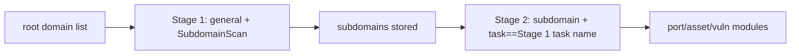

---

## name: scopesentry-mcp
description: Manage the security-scanning platform (projects, tasks, templates, assets, nodes) via the ScopeSentry MCP. Use when the user mentions ScopeSentry, MCP, API Key, scan tasks, or asset queries.

# ScopeSentry MCP guide

For users with a **deployed ScopeSentry instance**. Connect to the platform through Cursor (or another MCP client); no local source code needed.

## 1. Preparation

### 1.1 Confirm the service is reachable

- Default web UI: `http://<host>`
- MCP endpoint: `http://<host>/mcp` (if there is a reverse proxy or front-end proxy in front, use the actual `/mcp` address)

### 1.2 Create an API Key

1. Log in to the ScopeSentry web UI in a browser
2. Go to the **API Key** management page and create a key (or create one via an interface provided by the administrator)
3. Save the returned `ssk_...` string (**shown only once**)

### 1.3 Configure the Cursor MCP

Cursor → Settings → MCP → add a server:

```json
{
  "mcpServers": {
    "scopesentry": {
      "url": "http://<your-host>:8082/mcp",
      "headers": {
        "X-API-Key": "ssk_your-key"
      }
    }
  }
}
```

`Authorization: Bearer ssk_your-key` also works.

After configuring, restart the MCP or reload Cursor and confirm that `list_projects`, `list_assets`, etc. appear in the tool list.

---

## 2. Tool overview


| Tool                     | Purpose                |
| ---------------------- | ----------------- |
| `list_projects`        | project tree grouped by tag (with project IDs) |
| `list_projects_data`   | paginated project list, searchable by name     |
| `get_project`          | project detail              |
| `create_project`       | create a project              |
| `list_tasks`           | scan task list            |
| `get_task`             | task detail              |
| `list_scan_templates`  | scan template list            |
| `get_scan_template`    | template detail              |
| `list_plugin_modules`  | scan-pipeline module names          |
| `list_plugins`         | available plugins (with hash, default parameters) |
| `create_scan_template` | create a scan template            |
| `create_scan_task`     | create a scan task            |
| `list_assets`          | query assets of each kind (paginated list)       |
| `count_assets`         | count assets (`/api/assets/common/total`) |
| `get_asset_detail`     | asset or vulnerability detail           |
| `add_asset_tag`        | add a tag to an asset           |
| `list_nodes`           | scan node list            |


Each tool's parameters follow the MCP tool description (schema); `list_assets` / `count_assets` share the same search and filter syntax — read the `list_assets` description before querying assets.

When you need to know "how many in total", use `count_assets` (the web pagination-total endpoint); do not page through `list_assets` repeatedly just to count.

---

## 3. Common workflows

### 3.1 Query assets by project

When the user or context **already has a project condition**, prefer passing `filter.project` to narrow the range and avoid slow responses from too much cross-project data. If there is no clear project, a project filter is not mandatory.

1. `list_projects` or `list_projects_data` to get the target project's **ObjectID** (`id` / `children[].value`)
2. `list_assets` with `filter.project` (**must be the ID, not the project's Chinese name**)

```json
{
  "asset_type": "asset",
  "pageIndex": 1,
  "pageSize": 20,
  "search": "domain=^example.com",
  "filter": {
    "project": ["<project ObjectID>"]
  }
}
```

### 3.2 Create a scan task

1. `list_nodes` to get the online node names
2. `list_scan_templates` or `create_scan_template` to get the template **ObjectID**
3. `create_scan_task`: `name`, `node` required; `template` is the template ID (not the template name)

**Target source `targetSource` (same as the web UI):**

| targetSource | Description | Required parameters |
| --- | --- | --- |
| `general` | enter the target directly | `target` |
| `project` | read targets from a project | `project` (array of project ObjectIDs) |
| `asset` | search the web asset database | `search`; optional `project`, `filter`, `targetNumber` |
| `RootDomain` | search the root-domain database | `search`; optional `project`, `filter`, `targetNumber` |
| `subdomain` | search the subdomain database | `search`; optional `project`, `filter`, `targetNumber` |
| `UrlScan` | search the URL-scan results | `search`; optional `project`, `filter`, `targetNumber` |
| `*Source` (e.g. `subdomainSource`) | create from "selected/searched" on an asset page | `search` when `targetTp=search`; `targetIds` when `targetTp=select` |

**Example — scan root domains directly:**

```json
{
  "name": "example-subdomain-collection",
  "node": ["node-1"],
  "template": "<template ObjectID>",
  "targetSource": "general",
  "target": "example.com\nfoo.com",
  "project": ["<project ObjectID>"]
}
```

**Example — continue from the subdomain database (filter by the previous task name):**

```json
{
  "name": "example-ports-and-vulns",
  "node": ["node-1"],
  "template": "<follow-up-module template ObjectID>",
  "targetSource": "subdomain",
  "search": "task==\"example-subdomain-collection\"",
  "project": ["<project ObjectID>"]
}
```

### 3.3 Full reconnaissance of a root domain (two stages recommended)

When the input is a **root domain** and you want **full reconnaissance**, run two scans rather than the whole pipeline at once.

**Why:** distributed tasks are dispatched per **single target**. With a root domain as the target, once a node is assigned that root domain, the subdomains it finds on that node continue to run the follow-up modules on the same node, which easily causes uneven load, slowness and errors.

**Best practice:**

1. **Stage 1 — subdomain collection only**
   - `targetSource`: `general`
   - `target`: all root domains (multiple lines)
   - template: enable only `SubdomainScan`, `SubdomainSecurity` (subdomain scan + subdomain takeover)
   - use `get_task` to wait for the task to finish

2. **Stage 2 — follow-up modules**
   - `targetSource`: `subdomain`
   - `search`: `task=="<Stage 1 task name>"` (exact task-name match)
   - optional `project` to narrow the range
   - template: port scan, asset mapping, vulnerability scan, etc. (may omit SubdomainScan)
   - subdomains are dispatched as individual targets across nodes, for higher parallel efficiency

You can also filter the "subdomain" asset page by task name in the web UI and use "create task from subdomains" — the effect is the same.



### 3.4 Create a scan template

1. `list_plugin_modules` → list of module names
2. `list_plugins` (filterable by `module`) → each plugin's `hash` and default `parameter`
3. `create_scan_template`: use `modules` to specify "module → array of plugin hashes"

---

## 4. Asset queries (`list_assets` / `count_assets`)

`count_assets` uses the same `asset_type`, `search` and `filter` as `list_assets` and returns `{ "total": N }`, corresponding to the web `/api/assets/common/total`.

```json
{
  "asset_type": "subdomain",
  "search": "task==\"some task name\"",
  "filter": {"project": ["<project ObjectID>"]}
}
```

**Performance tips (apply to both `list_assets` / `count_assets`):** with a project condition, prefer `filter.project` to narrow the range; in `search`, use `==` exact or `^` prefix matching on indexed fields where possible (see [4.3](#43-search-expression)), to avoid slow responses from broad `=` fuzzy queries. Without a project context, a project filter is not mandatory.

The types that support `filter.project` are in the [4.4](#44-filter-exact-filtering) table.

### 4.1 Asset type `asset_type`

`asset`, `RootDomain`, `subdomain`, `app`, `mp`, `UrlScan`, `SensitiveResult`, `DirScanResult`, `crawler`, `vulnerability`, `PageMonitoring`, `IPAsset`, `SubdomainTakerResult`

Alias examples: `web`→asset, `vuln`→vulnerability, `ip`→IPAsset, `url`→UrlScan

### 4.2 Parameters


| Parameter                       | Description                                      |
| ------------------------ | --------------------------------------- |
| `pageIndex` / `pageSize` | pagination, default 1 / 20                            |
| `search`                 | search expression (see next section)                              |
| `filter`                 | exact-filter JSON (see next section)                          |
| `sort`                   | only UrlScan, DirScanResult support sorting by `length` |
| `sid`                    | SensitiveResult only: sensitive-rule name                |


`search` and `filter` **can be used together**.

### 4.3 search expression

A custom DSL (**not SQL**):


| Operator  | Meaning   | Index | Example                          |
| ---- | ---- | ---- | --------------------------- |
| `=`  | fuzzy match (regex) | no index | `domain=example`            |
| `==` | exact match | **uses index** | `port==443`                 |
| `!=` | exclude   | — | `port!="80"`                |
| `&&` | and    | — | `domain==example.com && port==443` |
| `||` | or    | — | `title=admin || body=login` |


**Indexes and operators:** fields such as `domain`, `ip`, `port`, `title` are indexed, but only **`==` exact** or a **prefix match on a value starting with `^`** (e.g. `domain=^example.com`) use the index; **`=` becomes a regex fuzzy match and cannot use the index**, which is slow on large data.

**search fields common to all types:** `tag`, `task` (task name), `rootDomain`

**`project` cannot go in search** (invalid, or errors when combined with `&&`). Use `filter.project` to filter by project.

**Common search fields per type:**


| asset_type           | fields                                                                                  |
| -------------------- | ----------------------------------------------------------------------------------- |
| asset                | domain, ip, port, service, app, title, statuscode, icon, banner, type, body, header |
| RootDomain           | domain, icp, company                                                                |
| subdomain            | domain, ip, type, value                                                             |
| app                  | name, icp, company, category, description, url, apk                                 |
| mp                   | name, icp, company, category, description, url                                      |
| UrlScan              | url, input, source, resultId, type                                                  |
| SensitiveResult      | url, sname, body, info, md5                                                         |
| DirScanResult        | url, statuscode, redirect, length                                                   |
| vulnerability        | url, vulname, matched, request, response, level                                     |
| crawler              | url, method, body, resultId                                                         |
| PageMonitoring       | url, hash, diff, response                                                           |
| IPAsset              | ip, domain, port, service, webServer, app                                           |
| SubdomainTakerResult | domain, value, type, response                                                       |


**search examples:**

- `domain==www.example.com && port==443` (exact, uses index)
- `domain=^example.com` (prefix match, uses index)
- `ip==192.168.1.1`
- `task=="some task name"`
- `level==high` (vulnerability)
- `statuscode==200` (DirScanResult)

Use `=` when you need a fuzzy contains, e.g. `title=admin` (no index; best combined with a project or other condition to narrow the range).

### 4.4 filter (exact filtering)

A JSON object: multiple values for the same key are **OR**, different keys are **AND**.

**Prefer `project` when there is a project condition:** if the user or context has a clear project and the asset_type supports `project`, include it to narrow the range; not mandatory without project info.


| filter key   | Meaning       | Value notes                                                     |
| ------------ | -------- | -------------------------------------------------------- |
| `project`    | owning project     | **ObjectID**, from `list_projects` / `list_projects_data` |
| `task`       | source task     | **task name**, from the `name` of `list_tasks`                         |
| `port`       | port       | e.g. `"443"`                                                |
| `service`    | service/protocol    | e.g. `"https"`                                              |
| `app`        | app fingerprint     | e.g. `"Nginx"`                                              |
| `icon`       | icon hash  |                                                          |
| `statuscode` | HTTP status code | mainly for asset                                               |
| `status`     | status       | UrlScan/DirScan HTTP code; vuln/sensitive-info processing status                       |
| `level`      | vulnerability level     | critical / high / medium / low / info                    |
| `type`       | type       | e.g. subdomain record type A, CNAME                                         |
| `color`      | sensitive-rule color   | SensitiveResult                                          |
| `sname`      | sensitive-rule name    | SensitiveResult                                          |
| `tags`       | tags       |                                                          |


**Available filter keys per type:**


| asset_type                            | filter key                                                      |
| ------------------------------------- | --------------------------------------------------------------- |
| asset                                 | project, port, service, app, icon, statuscode, type, task, tags |
| RootDomain                            | project, tags                                                   |
| subdomain                             | project, type, task, tags                                       |
| app / mp                              | project, tags                                                   |
| UrlScan                               | status, tags                                                    |
| DirScanResult                         | status, tags                                                    |
| SensitiveResult                       | status, color, sname, tags                                      |
| crawler                               | project, task, tags                                             |
| vulnerability                         | project, level, status, task, tags                              |
| PageMonitoring / SubdomainTakerResult | tags                                                            |
| IPAsset                               | project, port, service, app                                     |


**filter example:**

```json
{"project": ["<project ObjectID>"], "port": ["443"]}
```

**Combined query example:**

```json
{
  "asset_type": "asset",
  "search": "domain=^baidu && port==443",
  "filter": {"project": ["<project ObjectID>"]},
  "pageIndex": 1,
  "pageSize": 10
}
```

**Notes:**

- With a project condition, prefer `filter.project` (where supported); not mandatory without a project context
- Do not put the project's display name in `filter.project`
- Use `==` for known values and `^` for prefixes; avoid overusing `=` fuzzy matching on large tables
- For UrlScan HTTP status use `filter.status`; for DirScanResult you can use `statuscode==200` in search
- For SensitiveResult by rule name: `search` with `sname=rule name`, or `filter.sname`

### 4.5 Sorting

Only **UrlScan** and **DirScanResult** support it:

```json
{"length": "ascending"}
```

Other types ignore `sort` and default to sorting by time.

---

## 5. Scan-template module names

`TargetHandler`, `SubdomainScan`, `SubdomainSecurity`, `PortScanPreparation`, `PortScan`, `PortFingerprint`, `AssetMapping`, `AssetHandle`, `URLScan`, `WebCrawler`, `URLSecurity`, `DirScan`, `VulnerabilityScan`, `PassiveScan`

---

## 6. Troubleshooting


| Symptom        | Fix                                                 |
| --------- | -------------------------------------------------- |
| MCP has no tools   | check the URL, API Key, and whether ScopeSentry is running                    |
| 401 / 403 | recreate or replace the API Key                                    |
| assets not found     | confirm `filter.project` is an ObjectID; do not put project in search |
| template/task creation fails | `template` must be a template ObjectID; `node` must be an online node name            |
| query slow/stuck   | with a project, add `filter.project`; in search use `==` or `^` prefix on indexed fields, less `=`; reduce `pageSize` |


---
